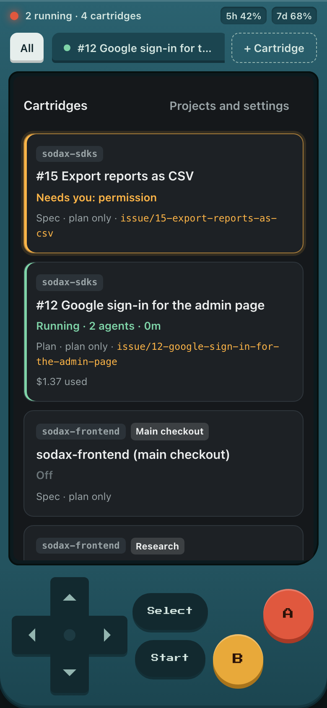
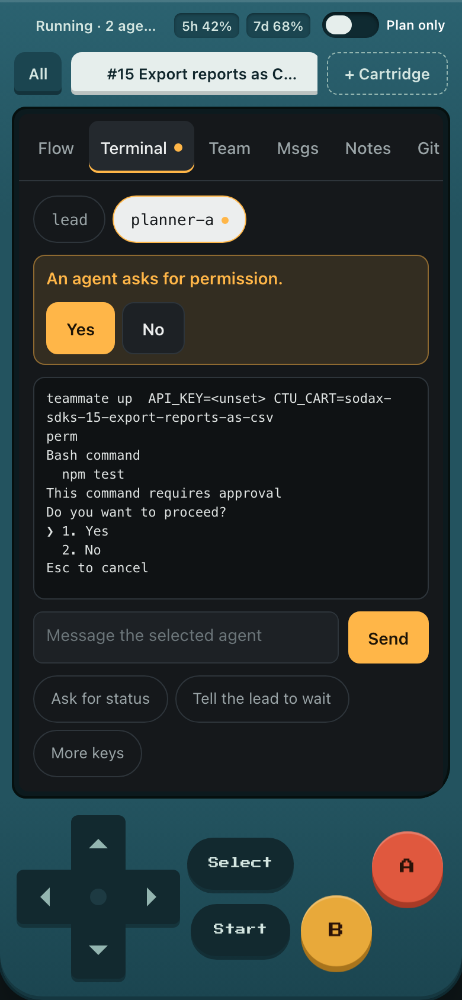
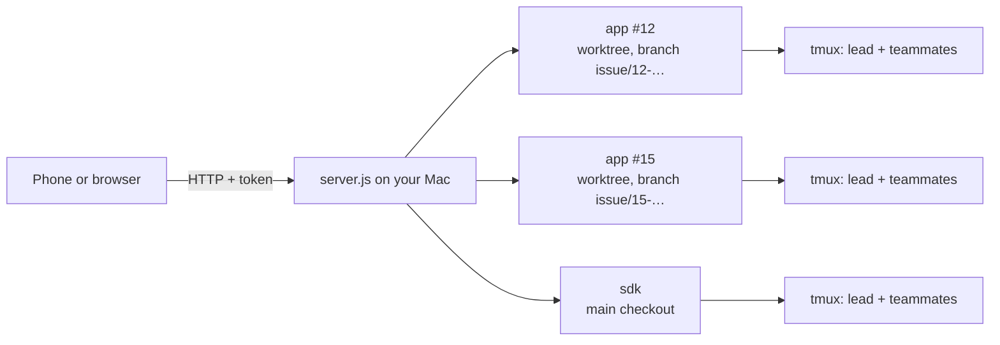
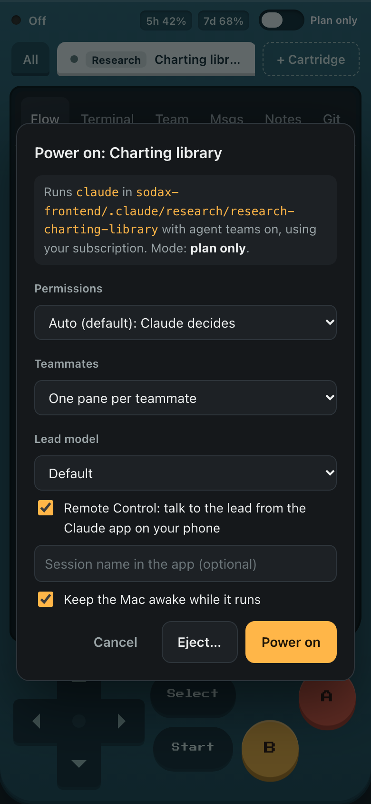
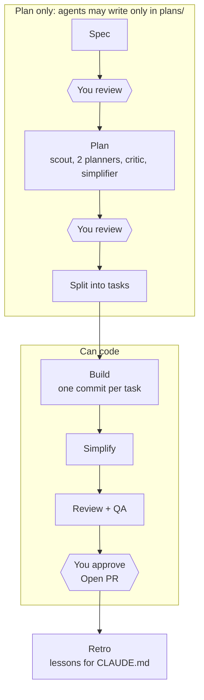

# Claude Team UI

A console in the browser for running Claude Code agent teams on your own machine, built to be used from a phone.
Each piece of work is a cartridge: its own git worktree and branch, its own tmux session with a lead and teammates,
and a gated workflow from spec to merge. One console handles several repositories.

No dependencies: Node 18+, tmux, git and Claude Code on a Pro or Max plan. gh is optional (issues and PRs).

<table>
  <tr>
    <td align="center"><br>Every cartridge at a glance</td>
    <td align="center"><br>The workflow of one cartridge</td>
    <td align="center"><br>An agent needs you: tap Yes or No</td>
  </tr>
</table>



## Start

```bash
brew install node tmux gh && gh auth login     # gh is optional
claude                                          # once: /login with your Pro/Max account, then /exit
./start.sh ~/code/repo-a ~/code/repo-b          # registers the repos and starts the console
./start.sh --lan                                # later: projects are remembered; --lan opens it to your phone
```

The terminal prints a link with the token. Open it once and the browser stays signed in for 30 days.
The token lives in `~/.config/claude-team-ui/token`.

From the phone: same Wi-Fi with `--lan`, or anywhere with [Tailscale](https://tailscale.com) on both devices.
Never expose the port to the internet directly. On iPhone, "Add to Home Screen" gives it a full-screen icon.
For push alerts when an agent waits for you, run with `NTFY_URL=https://ntfy.sh/<secret-topic>` and subscribe in the ntfy app.

## Using it

1. **+ Cartridge**, pick the project, then an issue, a new task (Claude can draft the issue), a review of a branch or PR,
   a research question, or the main checkout. You can name the branch and choose what it starts from.
2. Select the cartridge and press **Start**. Choose permissions (auto is Claude Code's default), the lead model,
   and whether to continue the lead's last conversation.
3. Press **Run** on the first phase. You can edit the prompt before it goes to the lead.
4. At each checkpoint, read the file in the console and **Approve** or **Ask for changes** (your feedback goes to the lead).
5. At the merge checkpoint, **Open PR** pushes the branch and opens a draft PR. Agents themselves can never push.
6. **Start → Eject** when done: the worktree goes, the branch stays, and the notebook is archived.

<table>
  <tr>
    <td align="center"><br>1. Add a cartridge</td>
    <td align="center"><br>2. Power on</td>
    <td align="center"><br>4. Review at a checkpoint</td>
    <td align="center"><br>Team, usage, messages</td>
  </tr>
</table>

Nothing runs on its own: adding a cartridge creates a worktree, a team only runs after Start, and each phase only
after Run. How many cartridges run at once is up to you; the console warns when several are running.

**Needs you.** The red light and the blinking chip mean an agent is waiting: a permission prompt, a question, or the
folder trust dialog. The terminal shows the right buttons (A = Enter, B = Esc, or "Trust folder").

**Quota.** The pills at the top show your plan usage for the 5-hour and 7-day windows, as Claude Code reports it.
Each cartridge also shows what it used (API-equivalent cost from Claude Code; on a subscription it measures quota,
not a bill). Cheaper teammate models in **Projects and settings** stretch the quota.

## Workflow

A work cartridge goes through these phases. Hexagons are checkpoints where you decide; nothing moves on without you.



| Cartridge | Phases |
|---|---|
| Work (issue or new task) | Spec → you review → Plan (scout, two planners, critic, simplifier, cross-review) → you review → Split into tasks → Build (one commit per task) → Simplify → Review + QA → you approve the merge → Retro |
| Review | Read-only review with cross-checking → you read the report |
| Research | Two researchers and a skeptic → you read the report with sources |

Teams write everything to `plans/` in their cartridge (the notebook). Reports from review and research cartridges can
be sent to a work cartridge from their checkpoint.

**Modes.** *Plan only* lets agents write only in `plans/`; *Can code* unlocks the code. The phase sets the mode, and the
switch (or Select) changes it by hand. The change applies at once to the lead and its teammates.

## What the tool guarantees

A `PreToolUse` hook (`hooks/guard.mjs`) checks every file edit, file read and shell command in sessions the console
started. Your own Claude sessions are not affected.

- Each team writes only inside its own cartridge: not in the main checkout, not in another cartridge.
- In plan-only mode, only `plans/` is writable.
- No `git push`, no `rm -rf`, no reading `.env` files (`.env.example` is fine).
- Sessions run on your subscription: the API key variables are removed for the lead and every teammate.
- Nothing the tool adds is committed: `plans/`, worktrees and the tool's files go into `.git/info/exclude`.
- The console never deletes a branch, and refuses to eject a cartridge with uncommitted changes.

Shell commands can still write files in plan-only mode; the prompts ask for read-only work, and the hook blocks the
file tools.

## Settings

| What | Where |
|---|---|
| Projects, teammate models, folders to scan for repos | Projects and settings in the console (`~/.config/claude-team-ui/config.json`) |
| Test command per project (used in prompts) | Projects and settings |
| Node version per project (from nvm, e.g. `24`; a repo's `.nvmrc` is used when set) | Projects and settings |
| Prompts and team rules per project | "Edit this project's template" in the Run dialog (`<project>/.claude/team-ui/prompts/`) |
| Default prompts | `prompts/` in this repo |
| Port, host, tmux prefix | `--port`, `--lan` / `--host`, `TEAM_UI_SESSION` |
| Soft limit for the "many cartridges running" warning | `TEAM_UI_SOFT_LIMIT` (default 3) |

## Good to know

- Watch any cartridge in a real terminal with `tmux attach -t ctu-<cartridge id>`.
- Teammates do not survive a restart; the lead can continue its conversation (Start → continue). The notebook stays.
- With teammates alive, Claude asks how to exit; **Exit cleanly** answers it for you.
- Agent teams are experimental in Claude Code. Team files and transcripts are read only, tolerantly, and never written.
  `docs/verify.md` lists what was checked against Claude Code 2.1.311.
- The Mac must stay on. The console keeps it awake while a cartridge runs (optional).

## Development

`npm test` runs an end-to-end test with fake `claude` and `gh` (`test/fakes`); it needs tmux and git, and calls no model.
`npm run check` checks syntax. Design notes and the API are in `docs/design.md`.
