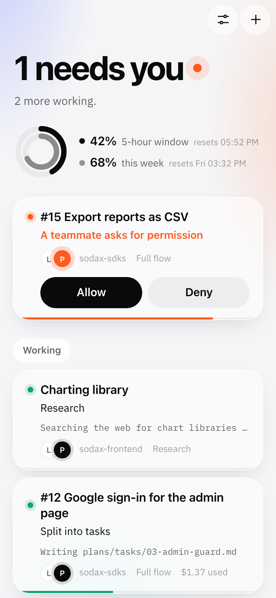
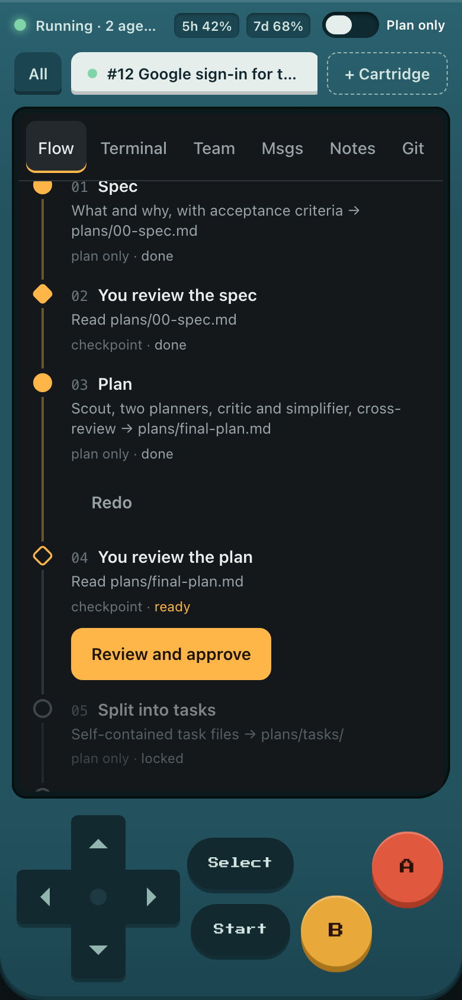
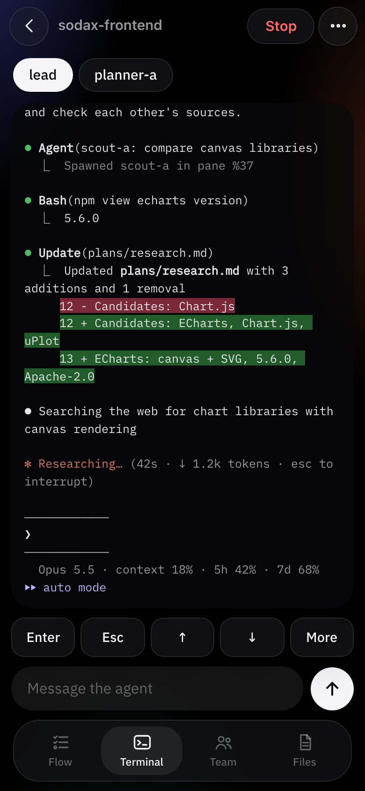
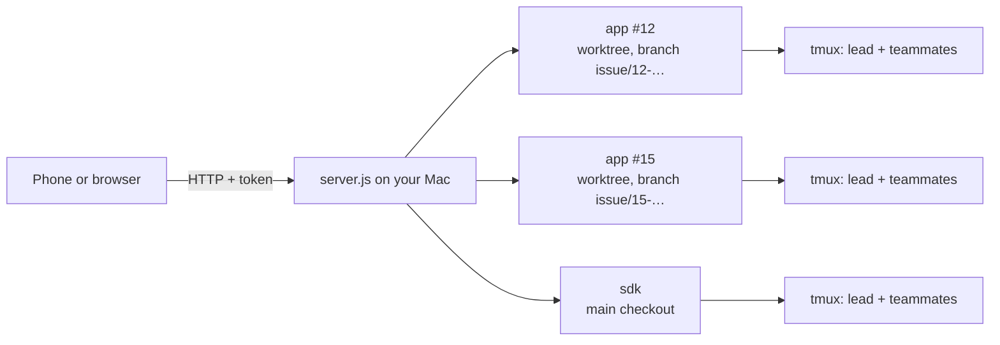
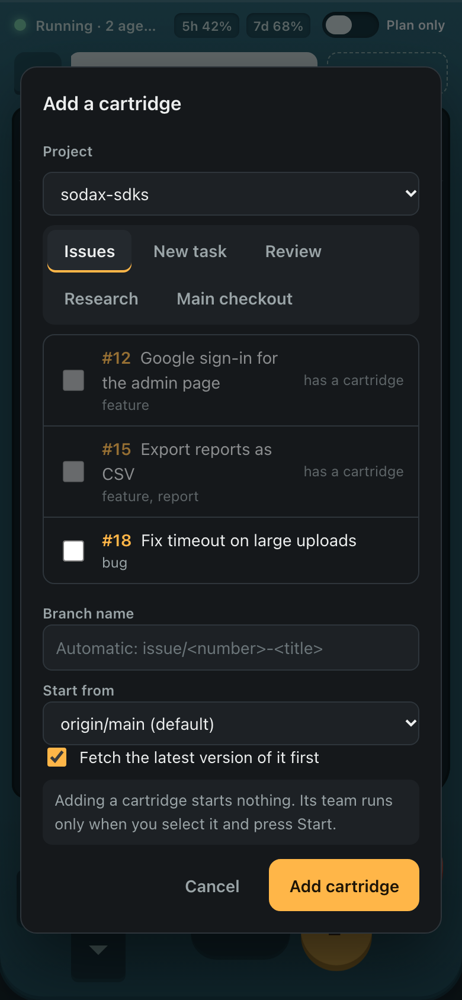
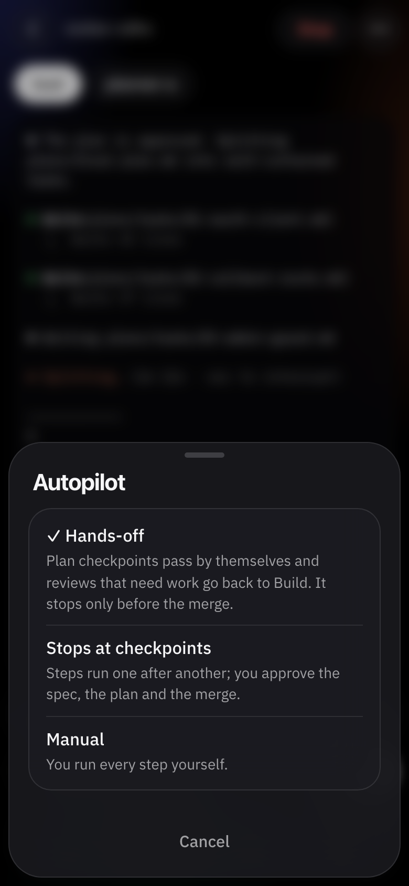
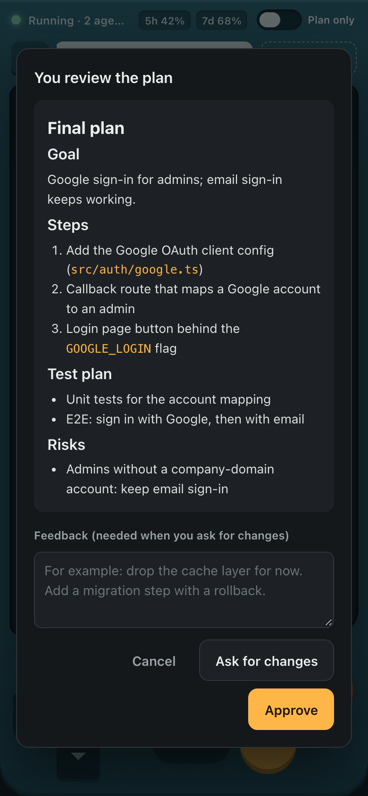
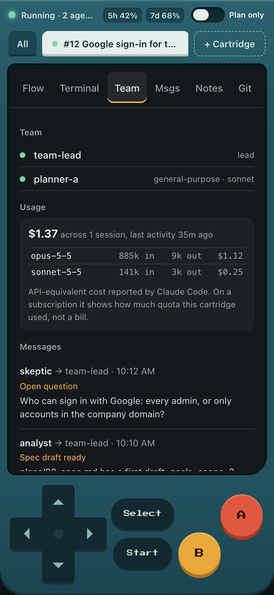
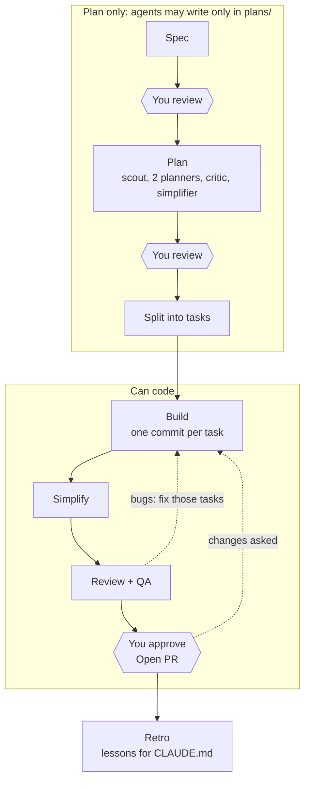

# Claude Team UI

A console in the browser for running Claude Code agent teams on your own machine, built to be used from a phone.
Each piece of work is a cartridge: its own git worktree and branch, its own tmux session with a lead and teammates,
and a gated workflow from spec to merge. One console handles several repositories.

No dependencies: Node 18+, tmux, git and Claude Code on a Pro or Max plan. gh is optional (issues and PRs).

<table>
  <tr>
    <td align="center"><br>What needs you, and what each team is doing</td>
    <td align="center"><br>One cartridge, working hands-off</td>
    <td align="center"><br>The real terminal, in colour</td>
  </tr>
</table>



## Start

```bash
brew install node tmux gh && gh auth login     # gh is optional
claude                                          # once: /login with your Pro/Max account, then /exit
./start.sh ~/code/repo-a ~/code/repo-b          # registers the repos and starts the console
./start.sh --lan                                # later: projects are remembered; --lan opens it to your phone
```

The terminal prints a link with the token. Open it once and the browser stays signed in for 30 days.
The token lives in `~/.config/claude-team-ui/token`.

From the phone: same Wi-Fi with `--lan`, or anywhere with [Tailscale](https://tailscale.com) on both devices.
Never expose the port to the internet directly. On iPhone, "Add to Home Screen" gives it a full-screen icon.
For push alerts when an agent waits for you, run with `NTFY_URL=https://ntfy.sh/<secret-topic>` and subscribe in the ntfy app.

### Runs at login

On macOS, `./start.sh --install [--lan|--tailscale]` (or `scripts/install-launchagent.sh`) writes
`~/Library/LaunchAgents/com.claude-team-ui.plist`, so launchd starts `node server.js` from this folder at login and again
whenever it stops. The agent gets no shell profile, so the folders of `node`, `tmux`, `gh`, `git` and `claude` found at
install time go into its `PATH`; run it again after moving one of them, or after changing the flag. Output goes to
`~/Library/Logs/claude-team-ui/out.log` and `err.log`. `--print` shows the plist without installing it, and
`--uninstall` stops the agent and removes it. `NTFY_URL`, when set at install time, is carried over.

## Using it

1. **+**, pick one or more issues (assigned to you, across all projects, by default; search, or filter by project,
   assignee, author, label, open or closed; pull requests by author, review requested, draft, review decision),
   or a new task, a review, research, the main folder. Then the flow by size:
   **Quick**, **Standard** or **Full**. **Add and start** creates the worktree, starts the team and runs the first step.
2. Each step ends by itself when the lead reports it done. **Autopilot** (⋯ menu, or the pill under the title) has three levels:
   **Hands-off** (default) passes the spec and plan checkpoints and sends a review that needs work back to Build, so it stops
   only before the merge; **Stops at checkpoints** waits for you to approve the spec and plan; **Manual** runs nothing by itself.
3. When an agent asks for permission, answer **Allow** or **Deny** straight from the home list or from any tab.
4. At the merge checkpoint, **Open a pull request** pushes the branch and opens a draft PR. Agents never push.
5. **⋯ → Eject** when done: the worktree goes, the branch stays, and the notebook is archived. A sheet then offers to
   delete the branch (only once it is merged), its remote copy (only once the pull request is merged) and the notebook.

<table>
  <tr>
    <td align="center"><br>1. Pick issues, from any project</td>
    <td align="center"><br>2. Choose how hands-off</td>
    <td align="center"><br>4. Approve the merge</td>
    <td align="center"><br>Team, usage, messages</td>
  </tr>
</table>

Adding a cartridge only creates a worktree; a team runs after Start (or Add and start). From there the autopilot level
decides how far it goes alone, and nothing is ever pushed or merged without you. How many cartridges run at once is up to
you; the console warns when several are running.

**Needs you.** The red light and the blinking chip mean an agent is waiting: a permission prompt, a question, or the
folder trust dialog. The terminal shows the right buttons (A = Enter, B = Esc, or "Trust folder").

**Quota.** The pills at the top show your plan usage for the 5-hour and 7-day windows, as Claude Code reports it.
Each cartridge also shows what it used (API-equivalent cost from Claude Code; on a subscription it measures quota,
not a bill). Cheaper teammate models in **Projects and settings** stretch the quota.

## Workflow

Three flows, by size. Every one of them builds and reviews the same five things: **logic, security, tests, docs and
skills** (`prompts/_checks.md`, editable per project).

| Flow | For | Team |
|---|---|---|
| Quick | small tasks | the lead writes a one-page plan → you review → the lead builds it alone → one reviewer covering all five checks → you approve the merge |
| Standard | medium tasks | a planner and a critic → you review → up to two developers → simplify → two reviewers (logic + security; tests + docs + skills) → you approve the merge |
| Full | big or risky work | the phases below |

In every flow, bugs found in review go back to the build, and only the affected work is fixed. The review after a fix
round keeps the earlier report (`plans/review-<n>.md`), checks each earlier finding, and reads only the diff since the
previous review.

**Full flow:** Hexagons are checkpoints where you decide; nothing moves on without you.



When Review + QA finds bugs, **Bugs → back to Build** (or **Send back to Build** at the merge checkpoint) returns to
the build: only the affected tasks are fixed, then Simplify and Review + QA run again.

| Cartridge | Phases |
|---|---|
| Work, quick flow | Spec + plan (lead alone) → you review → Build (lead alone) → Review (one reviewer) → you approve the merge |
| Work, standard flow | Spec + plan (planner + critic) → you review → Build (up to two developers) → Simplify → Review (two reviewers) → you approve the merge |
| Work, full flow | Spec → you review → Plan (scout, two planners, critic, simplifier, cross-review) → you review → Split into tasks → Build (one commit per task) → Simplify → Review + QA → you approve the merge → Retro |
| Review | Read-only review with cross-checking → you read the report |
| Research | Two researchers and a skeptic → you read the report with sources |

Teams write everything to `plans/` in their cartridge (the notebook). Reports from review and research cartridges can
be sent to a work cartridge from their checkpoint.

**Modes.** *Plan only* lets agents write only in `plans/`; *Can code* unlocks the code. The phase sets the mode, and the
switch (or Select) changes it by hand. The change applies at once to the lead and its teammates.

## Assistant

The round button at the bottom right opens a chat with an assistant that reads your projects, the notes in the folder
above them and GitHub (issues, pull requests, comments), and answers with a short conclusion, its evidence and an
English reply draft you can copy and paste to a teammate. Describe work and it drafts the issue. It runs `claude -p` on
your subscription with read-only tools; it never changes files or GitHub by itself.

What it proposes comes back as cards: create an issue, add a quick, standard or full cartridge for an issue, review a
PR, research a question, message a running team's lead, open a link. A card does something only when you tap it and
confirm, through the same code as the buttons, and the chat is told what happened. Each chat is one Claude Code
session, so you can keep asking. **New chat** (or holding the button) starts clean; **Chats** lists old ones and
deletes them. A chat keeps the scope it was opened with, shown under its title: the workspace, or the cartridge it was
opened from, whose task, steps and notebook it then knows. The model menu next to the box picks the model for that
chat (Haiku for a quick word, Opus for a hard question; Auto is the configured fast model). Drag the round button
when it covers something; it stays where you put it. In a cartridge's Files tab every notebook file has **Summary**
(a chat that sums it up), **Copy** and, on phones, **Share**.

It reads from the first folder under *Folders to scan* (or `assistant.cwd` in the config file), so an `AGENTS.md` or
`CLAUDE.md` there that says where your notes live makes it much better. Its prompt is `prompts/90-assistant.md`; a
project can replace it with `<project>/.claude/team-ui/prompts/90-assistant.md`.

## Chat

A running cartridge opens on **Chat**: the lead's conversation as messages, read from its transcript. Your own words
and the lead's replies are bubbles; the prompt of each step is a collapsed "Step: …" chip; what the console sent by
itself (a nudge, a send-back, a hand-over) is a "Console: …" line; the lead's tool calls fold into one line ("read 4
files, ran 2 commands"); messages from teammates show as notes. Type to talk to the lead; when an agent waits for you,
the Allow / Deny / Trust card sits above the composer.

Quick replies above the composer fit the moment: at the merge, **Fix all critical and major**, **Push fixes to the PR**,
**Run the review again** and **Explain finding 1…3**; when the lead waits, **Go with your recommendation** or **Skip it
for now**; with a pull request, **Check PR comments** and, when there are new ones, **Address them**. Fixing something
through the chat does not move the flow by itself: tap **Run the review again** or **Push** when you are done.

**Away mode.** When the lead asks you something in the middle of a step and you do not answer within the timeout
(Projects and settings, default 15 minutes; ⋯ → Away mode sets it per cartridge; 0 turns it off), it is told to decide
by itself and to note the choice under "Decided for you" in its summary. Only in hands-off and full auto; checkpoints
and the merge still wait for you. The ntfy push for a question carries the question text.

## Summary

Every step ends with a short, fixed-format section the lead appends to `plans/summary.md`: verdict, counts of
findings, acceptance criteria met, tests, what changed, the three findings that matter most with `file:line`,
questions for you, what it decided for you, and what happens next. At a checkpoint the Flow tab shows it as a card:
the verdict large, the findings with a tick box each and their `file:line` opening the code around it, and buttons for
**Fix selected**, **Fix all critical and major** and **Ignore minor, open the PR**. The home list shows the verdict
under each cartridge, and the ntfy push carries it. Without a section (an older prompt, or a lead that forgot), the card
shows the head of the step's report. The snippet is `prompts/_summary.md`, editable per project like the team rules.

## Tidy up

Worktrees fill the disk: every one gets its own `node_modules` and build output. **Tidy up** (on home when something
can be freed, with the amount, and under Settings → Storage) measures every cartridge folder in the background (cached
for ten minutes) and lists what can go, in groups with a tick each:

- **Finished cartridges** to eject: the pull request is merged or closed, or every step is done and the branch is pushed.
  Eject still refuses uncommitted changes and keeps the branch.
- **Idle cartridges** to hibernate: powered off and untouched for `hibernateDays` (7). Hibernating runs the project's
  clean-up command, or by default removes `node_modules`, `.turbo` and every `dist` and `.next` folder down to depth 3
  that git does not track. The worktree, branch and notebook stay; **Start** runs the setup command again first.
- **Leftovers**: stale worktree records (`git worktree prune`), worktree and research folders no cartridge owns (a
  worktree with uncommitted work is left alone; research folders hold their report and are not ticked), the setup log
  of a gone main-checkout cartridge, notebook archives older than 180 days.
- **Merged branches of ejected cartridges**, local and on `origin`, never ticked for you.
- **Deep clean** per project: `git gc --auto`, and `pnpm store prune` when pnpm is installed.

**Clean now** lists what will happen, runs it, and says how much was freed; each step goes to the project's
`actions.log`. Settings shows the storage in cartridges, archives and Claude Code's own transcripts
(`~/.claude/projects`), which Claude Code removes itself after `cleanupPeriodDays` (default 30); the console never
deletes there.

Home also shows how many Claude processes run and the memory they take (red above `ramWarnPct`, 70% of the Mac's
memory). A cartridge that only waits for you (a checkpoint, all steps done, or nothing run) and has not moved for
`idlePowerOffMin` (120; 0 = off) is powered off cleanly and marked so; **Start** continues the conversation. A step
that runs is never interrupted. Teammates left idle for 15 minutes after a step ended show as "N idle agents" with
**Dismiss**, which asks the lead to shut them down.

## Budget

Each cartridge can have a budget in dollars (⋯ → Budget, or the start dialog; the default for all is `defaultBudgetUSD`,
0 = none). Before autopilot runs the next step, it checks the cartridge's cost against the budget, and the plan usage
against `quotaPausePct` (90%) of the 5-hour or 7-day window. Over either, the step waits: one push says why ("Paused
before Build: $5.00 used of $4.00", "7-day quota at 92%"), and the ticket and the Flow tab offer **Run anyway** (runs the
step and raises the budget to the cost plus the same budget again) and **Raise budget**. Your own **Run** always runs.
The cost is Claude Code's API-equivalent figure from the transcripts; on a subscription it counts against your quota, not
a bill.

## What the tool guarantees

A `PreToolUse` hook (`hooks/guard.mjs`) checks every file edit, file read and shell command in sessions the console
started. Your own Claude sessions are not affected.

- Each team writes only inside its own cartridge: not in the main checkout, not in another cartridge.
- In plan-only mode, only `plans/` is writable.
- No `git push`, no `rm -rf`, no reading `.env` files (`.env.example` is fine).
- Sessions run on your subscription: the API key variables are removed for the lead and every teammate.
- Nothing the tool adds is committed: `plans/`, worktrees and the tool's files go into `.git/info/exclude`.
- Eject never deletes a branch and refuses a cartridge with uncommitted changes. A branch goes only when you tick it in
  Tidy up or after an eject, and only once it is merged.
- Project variables can never set `ANTHROPIC_*`, `CLAUDE*` or the guard's `CTU_*` variables.

Shell commands can still write files in plan-only mode; the prompts ask for read-only work, and the hook blocks the
file tools.

## Settings

| What | Where |
|---|---|
| Projects, teammate models, folders to scan for repos | Projects and settings in the console (`~/.config/claude-team-ui/config.json`) |
| Test command per project (used in prompts) | Projects and settings |
| Setup command per project (e.g. `pnpm install && pnpm build`): runs once in every new worktree, in the background; the first step waits for it, and a failure shows on the cartridge with its log | Projects and settings |
| Node version per project (from nvm, e.g. `24`; a repo's `.nvmrc` is used when set) | Projects and settings |
| Clean-up command per project, run when Tidy up hibernates a worktree (default: drop `node_modules`, `.turbo`, `dist`, `.next`) | Projects and settings |
| Environment variables per project (`KEY=VALUE` per line), for the cartridge's session, setup and clean-up; not `ANTHROPIC_*`, `CLAUDE*` or `CTU_*` | Projects and settings |
| Idle power-off minutes (`idlePowerOffMin`, 120), hibernate after days (`hibernateDays`, 7), memory warning (`ramWarnPct`, 70) | Projects and settings |
| Budget per cartridge (`defaultBudgetUSD`, 0 = none; per cartridge under ⋯ → Budget) and the quota pause (`quotaPausePct`, 90) | Projects and settings |
| Prompts and team rules per project | "Edit this project's template" in the Run dialog (`<project>/.claude/team-ui/prompts/`) |
| Default prompts | `prompts/` in this repo |
| Assistant: the folder it reads from, its model | `assistant.cwd` and `assistant.model` in `config.json` (defaults: the first scan root, the fast model) |
| Away mode: minutes a mid-step question waits for you before the lead decides (0 = off) | Projects and settings; per cartridge under ⋯ → Away mode |
| The summary every step appends to `plans/summary.md` | `prompts/_summary.md`, editable per project like the team rules |
| Port, host, tmux prefix | `--port`, `--lan` / `--host`, `TEAM_UI_SESSION` |
| Soft limit for the "many cartridges running" warning | `TEAM_UI_SOFT_LIMIT` (default 3) |

## Good to know

- Watch any cartridge in a real terminal with `tmux attach -t ctu-<cartridge id>`.
- Teammates do not survive a restart; the lead can continue its conversation (Start → continue). The notebook stays.
- With teammates alive, Claude asks how to exit; **Exit cleanly** answers it for you.
- Agent teams are experimental in Claude Code. Team files and transcripts are read only, tolerantly, and never written.
  `docs/verify.md` lists what was checked against Claude Code 2.1.311.
- The Mac must stay on. The console keeps it awake while a cartridge runs (optional).

## Two machines

Projects and settings live in `~/.config/claude-team-ui/config.json` with absolute paths. To share them, export a
manifest with paths relative to a common root, keep it in a synced repo, and import it on the other machine:

```bash
node bin/team-ui-config.js export ~/sync/team-ui.json --root ~/work     # machine A
node bin/team-ui-config.js import ~/sync/team-ui.json --root ~/work     # machine B (adds, never removes)
# Per-project prompts (rules, checks) travel in ~/sync/prompts/<project>/ next to the manifest.
```

The login token and plan usage stay per machine.

## Development

`npm test` runs an end-to-end test with fake `claude` and `gh` (`test/fakes`); it needs tmux and git, and calls no model.
`npm run check` checks syntax. Design notes and the API are in `docs/design.md`.
